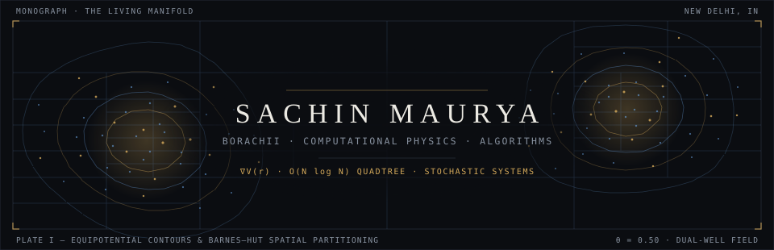
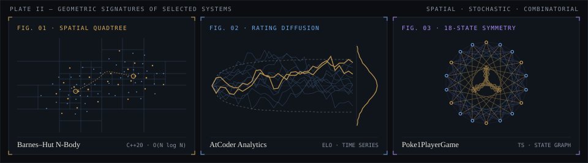
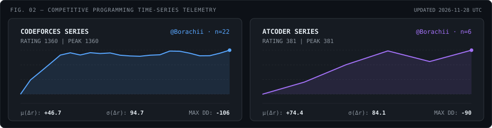
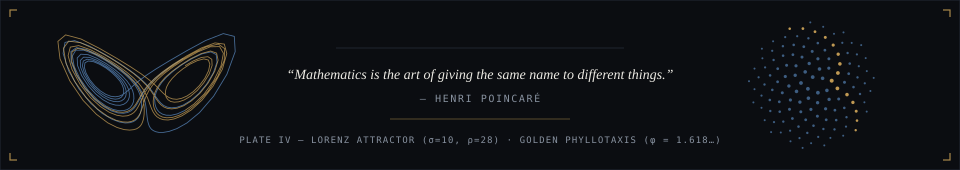

<!-- Plate I: Equipotential Contours & Barnes-Hut Spatial Partitioning -->
<picture>
  <source media="(prefers-color-scheme: dark)" srcset="./assets/manifold-hero-dark.svg" />
  <source media="(prefers-color-scheme: light)" srcset="./assets/manifold-hero-light.svg" />
  
</picture>

 

**[Portfolio](https://portfolio-rho-peach-ffjrw4wa6a.vercel.app/)** &nbsp;·&nbsp; **[Codeforces](https://codeforces.com/profile/Borachii)** &nbsp;·&nbsp; **[AtCoder](https://atcoder.jp/users/Borachii)** &nbsp;·&nbsp; **[LeetCode](https://leetcode.com/u/Borachi18x24/)** &nbsp;·&nbsp; **[CSES](https://cses.fi/)**

 

<picture>
  <source media="(prefers-color-scheme: dark)" srcset="./assets/harmonic-rule-dark.svg" />
  <source media="(prefers-color-scheme: light)" srcset="./assets/harmonic-rule-light.svg" />
  
</picture>

### I &nbsp;·&nbsp; Notes on Focus

> *CS Undergrad @ MAIT, Delhi — building systems where geometry, dynamics, and algorithms meet.*

- **Spatial & Physical Systems** — Writing high-performance **C++20** gravitational engines, recursive quadtrees, and deterministic numerical pipelines.
- **Stochastic & Algorithmic Thinking** — Exploring probability, mean-reverting dynamics, combinatorics, dynamic programming, and graph topology alongside daily competitive programming.
- **Problem Setting** — Designing original algorithmic problems, test generators, and contest narratives for university programming competitions.

| Live Monograph | Source |
| :---: | :---: |
| **[The Living Manifold →](https://portfolio-rho-peach-ffjrw4wa6a.vercel.app/)** | **[SachinMaurya24/Portfolio](https://github.com/SachinMaurya24/Portfolio)** |

 

<picture>
  <source media="(prefers-color-scheme: dark)" srcset="./assets/harmonic-rule-dark.svg" />
  <source media="(prefers-color-scheme: light)" srcset="./assets/harmonic-rule-light.svg" />
  
</picture>

### II &nbsp;·&nbsp; Selected Systems

<!-- Plate II: Geometric Signatures of Selected Systems -->
<picture>
  <source media="(prefers-color-scheme: dark)" srcset="./assets/systems-triptych-dark.svg" />
  <source media="(prefers-color-scheme: light)" srcset="./assets/systems-triptych-light.svg" />
  
</picture>

 

<table>
<tr>
<td width="33.3%" valign="top">

#### [Barnes–Hut N-Body](https://github.com/SachinMaurya24/Barnes-Hut-N-Body-Simulator)
Hierarchical spatial-partitioning gravity engine simulating two-galaxy mergers via recursive quadtrees, exporting CSV state snapshots and FFmpeg phase animations.

`C++20` `Quadtree` `Python` `FFmpeg`

</td>
<td width="33.3%" valign="top">

#### [AtCoder Analytics](https://github.com/SachinMaurya24/Atcoder-profile-checker)
Rating telemetry dashboard surfacing AtCoder performance trajectories, difficulty distributions, and contest drift omitted from the default profile.

`JavaScript` `REST API` `Time Series`

</td>
<td width="33.3%" valign="top">

#### [Poke1PlayerGame](https://github.com/SachinMaurya24/Poke1PlayerGame)
Deterministic single-player turn-based battle engine built from scratch around an 18-type interaction graph and structured state-machine transitions.

`TypeScript` `State Machines`

</td>
</tr>
</table>

 

<picture>
  <source media="(prefers-color-scheme: dark)" srcset="./assets/harmonic-rule-dark.svg" />
  <source media="(prefers-color-scheme: light)" srcset="./assets/harmonic-rule-light.svg" />
  
</picture>

### III &nbsp;·&nbsp; Competitive Programming Telemetry

<!-- Plate III: Live Quant-Style CP Time Series (Auto-updated daily via GitHub Actions) -->
<picture>
  <source media="(prefers-color-scheme: dark)" srcset="./assets/cp-telemetry-dark.svg" />
  <source media="(prefers-color-scheme: light)" srcset="./assets/cp-telemetry-light.svg" />
  
</picture>

  

<!-- Plate IV: Lorenz Attractor & Golden Phyllotaxis Colophon -->
<picture>
  <source media="(prefers-color-scheme: dark)" srcset="./assets/attractor-colophon-dark.svg" />
  <source media="(prefers-color-scheme: light)" srcset="./assets/attractor-colophon-light.svg" />
  
</picture>

