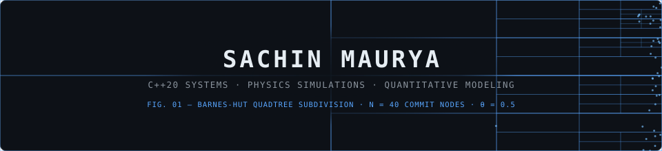

<!-- Dynamic Barnes–Hut Quadtree Header (Auto-updated daily via GitHub Actions) -->
<picture>
  <source media="(prefers-color-scheme: dark)" srcset="./assets/quadtree-dark.svg" />
  <source media="(prefers-color-scheme: light)" srcset="./assets/quadtree-light.svg" />
  
</picture>

  

<!-- Navigation Badges -->

---

### ✦ 01 · Profile

> **CS Undergrad @ MAIT, Delhi** — focused on numerical methods, low-level performance, and mathematical engineering.

- **Systems & Simulation:** Writing high-performance **C++20** physics engines, spatial data structures, and computational models.
- **Quantitative & Algorithmic:** Studying **probability, stochastic processes, and algorithmic trading** alongside daily competitive programming (DP, bitmasking, combinatorics, graph theory).
- **Problem Setting:** Authoring original algorithmic problem sets and contest narratives for college programming competitions.

| Live Portfolio | Source Repository |
| :---: | :---: |
| **[Explore Interactive Portfolio →](https://portfolio-rho-peach-ffjrw4wa6a.vercel.app/)** | **[SachinMaurya24/Portfolio](https://github.com/SachinMaurya24/Portfolio)** |

---

### ✦ 02 · Featured Systems (Mathematical Spec Cards)

#### 🌌 [Barnes–Hut N-Body Simulator](https://github.com/SachinMaurya24/Barnes-Hut-N-Body-Simulator)
> *Hierarchical spatial-partitioning gravitational engine for two-body galaxy mergers.*

$$\frac{s}{d} < \theta \implies \mathbf{F}_i \approx -\sum_{k} \frac{G m_i M_k}{\left(\|\mathbf{r}_i - \mathbf{R}_k\|^2 + \varepsilon^2\right)^{3/2}}(\mathbf{r}_i - \mathbf{R}_k)$$

- **Complexity Reduction:** Compresses pairwise gravitational evaluation from $O(N^2)$ to $O(N \log N)$ via recursive quadtree multipole approximation.
- **Pipeline:** Outputs deterministic CSV particle state snapshots, time-labeled phase plots, and FFmpeg merger animations.
- **Stack:** `C++20` `Quadtree` `Computational Physics` `Python` `FFmpeg`

<!-- Uncomment once your showcase image/GIF path is confirmed in the Barnes-Hut repo -->
<!-- 

 -->

 

<table>
<tr>
<td width="50%" valign="top">

### 📊 [AtCoder Profile Checker](https://github.com/SachinMaurya24/Atcoder-profile-checker)

$$E_A = \frac{1}{1 + 10^{(R_B - R_A)/400}}$$

Analytics dashboard surfacing AtCoder performance history, total solved distributions, and contest telemetry omitted from the default profile.

`JavaScript` `REST API` `Competitive Programming`

</td>
<td width="50%" valign="top">

### 🎮 [Poke1PlayerGame](https://github.com/SachinMaurya24/Poke1PlayerGame)

$$\text{Damage} = \left\lfloor \left(\frac{2L}{5} + 2\right) \cdot P \cdot \frac{A}{D} \cdot \frac{1}{50} + 2 \right\rfloor \cdot M$$

Deterministic single-player turn-based battle engine built from scratch with type-multiplier state transitions and interactive combat mechanics.

`TypeScript` `State Machines` `Game Systems`

</td>
</tr>
</table>

---

### ✦ 03 · Competitive Programming Telemetry

<!-- Live Quant-Style CP Time Series (Auto-updated daily via GitHub Actions) -->
<picture>
  <source media="(prefers-color-scheme: dark)" srcset="./assets/cp-telemetry-dark.svg" />
  <source media="(prefers-color-scheme: light)" srcset="./assets/cp-telemetry-light.svg" />
  
</picture>

